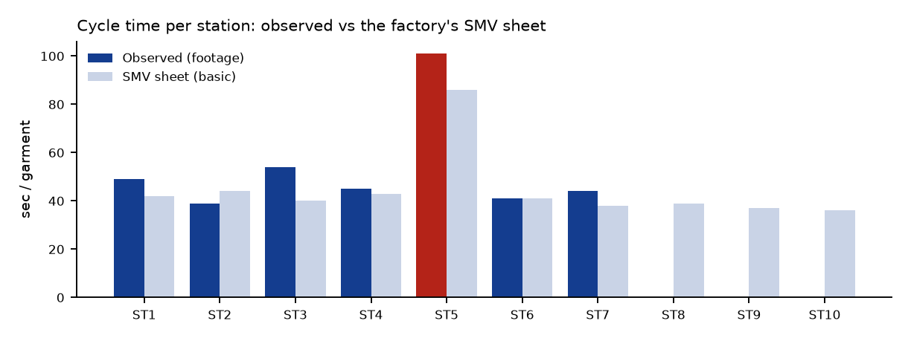
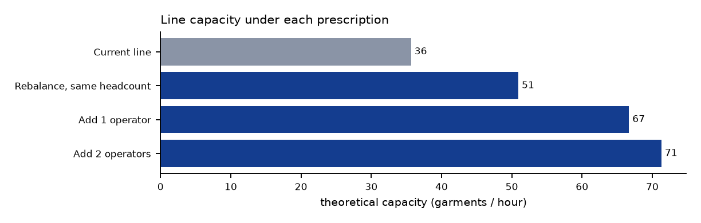

# Kaarkhana


**An on-device industrial engineer for garment production lines.**

Point a camera at a line and Kaarkhana watches the **bundles of cut fabric**, not the workers. It measures how long each station stays busy, how much work queues in front of it, identifies the constraint, reconciles the findings against the factory's own SMV sheet, and writes a costed rebalance report a plant manager can sign.

**No API key. No cloud. No per-minute cost.** Analysis runs on your machine and footage never leaves it. The only optional network activity is downloading an open-weight model for the SAM 3 detector or the local LLM polish.

---

## Why it exists

Most garment lines are balanced on paper and drift in reality. An industrial engineer with a stopwatch can find the constraint, but only for a few stations at a time and only occasionally. Kaarkhana turns ordinary line footage into a repeatable, evidence-backed time study:

- **Bundle-centric, not person-centric** — no worker identity, biometrics or performance scoring.
- **Explainable** — every number in the narrative is traced to a measurement or an explicit costing input.
- **Actionable** — outputs same-headcount and +1/+2 operator scenarios with a daily/annual cost estimate.
- **Signable** — a PDF report with charts, SMV reconciliation, assumptions and a signature block.

## What you get

| Output | Purpose |
|---|---|
| `kaarkhana_report.pdf` | Evidence charts, station metrics, SMV table, options, assumptions, signature block |
| `station_metrics.csv` | Per-station cycles, busy fraction, queue statistics and evidence |
| `bundle_events.csv` | Raw arrive/work/depart event stream used for the measurements |
| `smv_reconciliation.csv` | Observed time vs basic/standard SMV and deviation flags |
| `results.json` | Machine-readable summary, scenarios, costing and narrative |
| `chart_*.png` | Cycle, timeline and scenario charts embedded in the PDF |

Example outputs from the bundled 150-second clip are in [`examples/sample_run/`](examples/sample_run/):

[Report PDF](examples/sample_run/kaarkhana_report.pdf) · [Results JSON](examples/sample_run/results.json) · [Station metrics](examples/sample_run/station_metrics.csv)




---

## Quick start

Requires **Python 3.10+**. Run the commands from the repository root; the CLI and UI resolve `assets/` and `samples/` relative to the current directory.

```bash
python -m venv .venv
# Windows:  .venv\Scripts\activate
# macOS/Linux:  source .venv/bin/activate

pip install -r requirements.txt
```

Analyse the bundled sample line:

```bash
python -m kaarkhana analyze samples/sim_line_clip_150s.mp4 \
  --line assets/sim10_line.json \
  --out out
```

You should see the constraint, a costed recommendation, and the path to the generated report.

### Optional: browser UI

```bash
streamlit run app.py
```

Upload a line video, edit costing inputs in the sidebar, and download the PDF/JSON from the browser. Everything stays on localhost.

### Optional: Google Colab

Open [`notebooks/kaarkhana_colab.ipynb`](notebooks/kaarkhana_colab.ipynb) in Colab, upload this project as `kaarkhana.zip`, and run top to bottom. The notebook downloads the report at the end. A free T4 GPU is only needed for the optional SAM 3 detector.

---

## CLI reference

```bash
python -m kaarkhana analyze VIDEO --line LINE_JSON [options]
```

| Flag | Description |
|---|---|
| `--line` | **Required.** Line configuration JSON (see below). |
| `--out` | Output directory (default: `results`). |
| `--detector` | `classical` (default, CPU, free) or `sam3` (optional, GPU). |
| `--sam-model` | Hugging Face checkpoint for SAM 3 (default: `facebook/sam3`). |
| `--anchors` | `x1,y1,x2,y2` pixel centres of the first and last station, if plates are not auto-detected. |
| `--hz` | Sampling rate in frames per second (default: `10`). |
| `--max-seconds` | Limit the analysed duration. |
| `--feed-rate` | Cutting-table release rate in garments/hour; caps promised savings. |
| `--wage` / `--cm-usd` | Override operator cost and cut-and-make price for this run. |
| `--llm` | Polish wording with a small local LLM. Output is rejected if it introduces any number not in the facts. |

Example with overrides:

```bash
python -m kaarkhana analyze my_line.mp4 --line my_line.json \
  --anchors 120,540,1820,540 --feed-rate 60 --wage 120 --cm-usd 1.10 --out report/
```

---

## Configuring your own line

Copy [`assets/sim10_line.json`](assets/sim10_line.json) and edit it:

```json
{
  "name": "My line",
  "style": "Polo shirt",
  "pitch_m": 3.0,
  "time_scale": 1.0,
  "stations": [
    {
      "id": "ST1",
      "name": "Shoulder Join",
      "machine": "4-Thread Overlock",
      "basic_smv_min": 0.70,
      "std_smv_min": 0.805,
      "operators": 1
    }
  ],
  "costing": {
    "wage_bdt_per_hr": 100.0,
    "cm_usd_per_piece": 1.00,
    "usd_to_bdt": 122.0,
    "hours_per_day": 8.0,
    "days_per_year": 300,
    "realisation": 0.6
  }
}
```

| Field | Meaning |
|---|---|
| `pitch_m` | Real distance between adjacent stations; geometry is expressed in station pitches, so camera distance and resolution do not matter. |
| `time_scale` | Real seconds per video second. Use `1.0` for real-time footage; the bundled simulator clip uses `10.0`. |
| `basic_smv_min`, `std_smv_min` | Basic and standard minutes from the factory's SMV sheet. |
| `operators` | Operators currently assigned to the station. |
| `costing` | Wage, cut-and-make price, FX rate, shift length, working days and realised share of the theoretical gain. **Defaults are placeholders — set your own.** |

**Filming tips:** fixed tripod, side-on or high-oblique view, whole line in frame, station plates visible. One to two minutes is the minimum; five or more is better. Press `H` in the bundled simulator to hide its HUD before recording.

---

## How it works

| Stage | Module | What it does |
|---|---|---|
| Calibrate | `calibrate.py` | Auto-finds station plates, or uses the supplied anchors; works in station-pitch units. |
| See | `detect.py` | `ClassicalDetector` (CPU, default) or optional text-prompted `SamDetector` (SAM 3). |
| Measure | `measure.py`, `events.py` | Work-spot and queue signals become arrive/work/depart events; bundles are separated by gaps or colour change. |
| Decide | `analysis.py` | Constraint = longest cycle per operator, corroborated by downstream starvation and WIP queue; confidence is graded. |
| Reconcile | `analysis.reconcile` | Observed vs SMV sheet; flags stations deviating more than 25% from the line's own pace. |
| Prescribe | `balance.py` | Same-headcount task shift or +1/+2 operators (optimal min-max), with costing. |
| Explain | `agent.py` | Deterministic, number-by-number justification; optional local LLM polish guarded against invented numbers. |
| Report | `report.py` | PDF with evidence charts, SMV table, options, assumptions and signature block. |
| Validate | `validate.py` | Scores results against known simulated cycle times. |

---

## Validation and honest limits

Validated on a **simulated** line with known cycle times ([details](docs/VALIDATION.md), [raw scores](docs/validation_results.json)):

- Correct bottleneck identified at high confidence.
- Pearson correlation of about **0.96–0.97** with the true cycle-time profile.
- Station-to-station ratios are reliable; absolute seconds read roughly **1.1–1.3x high** because a visit includes hand-off time.

**Not yet validated on a live factory floor.** Before changing a real line, do a stopwatch time study and review the report with your industrial engineer.

Other limits:

- The classical detector can miss pale/white fabric, so downstream completion counts and absolute throughput are not trustworthy; relative station comparisons are.
- Reporting two different bases is intentional: the factory sheet's own proposal is **52% → 92%** balance, while the recommendation derived from the bundled footage reports the observed basis (**about 50% → 86%**). Both appear in the PDF.
- Savings are estimates driven by editable wage, price and realisation inputs.
- The SAM 3 path matches the current Hugging Face `facebook/sam3` API but could not be executed offline during development; test it on your footage and compare with the classical result.
- Kaarkhana assumes a fixed camera and a side-on/high-oblique view of a straight line. U-lines and overhead cameras are not supported yet.

---

## Project layout

```text
kaarkhana/
├── app.py                     # Streamlit UI
├── requirements.txt
├── kaarkhana/                 # analysis package
│   ├── cli.py                 # python -m kaarkhana analyze ...
│   ├── pipeline.py            # video → measurements → report
│   ├── calibrate.py           # station geometry
│   ├── detect.py              # classical + optional SAM 3 detectors
│   ├── measure.py             # signal extraction
│   ├── events.py              # bundle event construction
│   ├── analysis.py            # constraint detection + SMV reconciliation
│   ├── balance.py             # rebalance scenarios + costing
│   ├── agent.py               # deterministic narrative + optional LLM
│   ├── report.py              # PDF generation
│   └── validate.py            # simulation scoring
├── assets/                    # example line config and ground truth
├── docs/                      # validation notes and scores
├── examples/                  # worked outputs (sample and full run)
├── notebooks/                 # Colab notebook
├── samples/                   # bundled 150 s demo clip
├── sim/                       # 3D line simulator and SMV workbook
└── tests/                     # unit tests
```

---

## Testing

```bash
python -m pytest tests
```

The suite covers the factory-sheet rebalance, multi-operator task shifting, feed-rate caps, bundle splitting, the constraint heuristic, the LLM numeric guard and the SMV-driven narrative. Validation against the simulator is available through `kaarkhana.validate.score()`.

## Privacy and ethics

Kaarkhana observes **bundles, not people**. It does not identify workers, track individuals or score personal performance. Video is processed locally; no footage or measurement is uploaded. Optional open-weight model downloads require the user's explicit action and, for SAM 3, acceptance of the model licence on Hugging Face.

Reports are decision support, not an automated management decision. A human engineer should review the evidence, assumptions and costing before acting on a recommendation.

## Hackathon note

Built for the Meta Global AI Developer Hackathon. The project uses Meta's open-weight SAM 3 for optional zero-shot bundle segmentation and a small local open-weight model for wording polish, rather than paid hosted APIs. Check the event's current rules before relying on a specific hosted Meta tool.

## License

MIT — see [LICENSE](LICENSE).
